# MuebleMundo — Tienda online de muebles

Trabajo Práctico Integrador Final · Desarrollo Web 2 · UNTDF

SPA de e-commerce hecha con React. Tiene catálogo con búsqueda, filtros y orden, detalle de producto, login con roles, carrito, compra simulada y un panel de administración con CRUD de productos, categorías y tags.

> **Importante:** la seguridad es **simulada** (no hay servidor) y los datos son locales. Mirá la sección [Seguridad y datos](#seguridad-y-datos).

## Índice

1. [Tecnologías](#tecnologías)
2. [Instalación y ejecución](#instalación-y-ejecución)
3. [Cuentas demo y permisos](#cuentas-demo-y-permisos)
4. [Rutas](#rutas)
5. [Seguridad y datos](#seguridad-y-datos)
6. [Funcionalidades](#funcionalidades)
7. [Modelo de datos y dependencias](#modelo-de-datos-y-dependencias)
8. [Estructura del proyecto](#estructura-del-proyecto)
9. [Capturas](#capturas)
10. [Pruebas realizadas](#pruebas-realizadas)
11. [Limitaciones y mejoras posibles](#limitaciones-y-mejoras-posibles)

## Tecnologías

| Tecnología | Versión | Uso |
|---|---|---|
| Vite | 8 | Servidor de desarrollo y compilación |
| React | 19 | Interfaz (componentes funcionales, hooks y Context API) |
| React Router | 7 | Navegación, rutas dinámicas y rutas protegidas |
| Tailwind CSS | 4 | Estilos, con una paleta beige propia (`src/index.css`) |
| ESLint | 10 | Control de calidad del código |

## Instalación y ejecución

**Requisitos:** Node.js 20.19 o superior (o 22.12 o superior) y npm.

```bash
cd tp-web-II
npm install        # instala las dependencias
npm run dev        # servidor de desarrollo (por defecto: http://localhost:5173)
```

| Comando | Descripción |
|---|---|
| `npm run build` | Genera la versión de producción en `dist/` |
| `npm run preview` | Sirve `dist/` localmente para probarla |
| `npm run lint` | Revisa el código con ESLint |

No hace falta ninguna variable de entorno, clave ni archivo `.env`.

## Cuentas demo y permisos

| Usuario | Contraseña | Rol |
|---|---|---|
| `admin` | `1234` | Administrador |
| `usuario` | `1234` | Cliente |

| Acción | Visitante | Cliente | Admin |
|---|---|---|---|
| Ver catálogo y detalle | Sí | Sí | Sí |
| Buscar, filtrar y ordenar | Sí | Sí | Sí |
| Agregar al carrito / comprar | Debe iniciar sesión | Sí | Sí |
| CRUD de productos | No | No | Sí |
| CRUD de categorías | No | No | Sí |
| CRUD de tags | No | No | Sí |

## Rutas

| Ruta | Pantalla | Acceso |
|---|---|---|
| `/` | Inicio: categorías, secciones por tag y buscador | Público |
| `/productos` | Catálogo con búsqueda, filtros, orden y estados de carga, error y vacío | Público |
| `/productos/:id` | Detalle de un producto | Público |
| `/login` | Inicio y cierre de sesión | Público |
| `/carrito` | Carrito | Requiere sesión (`ProtectedRoute`) |
| `/checkout` | Confirmación de compra simulada | Requiere sesión (`ProtectedRoute`) |
| `/admin` | Redirige a `/admin/productos` | Solo admin (`AdminRoute`) |
| `/admin/productos` | CRUD de productos | Solo admin |
| `/admin/categorias` | CRUD de categorías | Solo admin |
| `/admin/tags` | CRUD de tags | Solo admin |
| `/403` | Acceso denegado | Público |
| `*` | Página no encontrada (404) | Público |

Sin sesión, las rutas protegidas redirigen a `/login` y, después de ingresar, se vuelve a la página que se había pedido. Si un cliente intenta entrar a `/admin/*`, va a `/403`.

## Seguridad y datos

### Origen de los datos (Modalidad A)

- Los datos iniciales están en `src/data/api-fake.json` (24 productos, 4 categorías y 3 tags) y se leen con `fetch`.
- Crear, editar y eliminar modifican **solo el estado de la aplicación y `localStorage`**. **Los POST/PUT/DELETE no modifican el archivo JSON ni ningún servidor.** Cada navegador tiene su propia copia de los datos.
- Claves de `localStorage`: `datosTienda` (catálogo), `sesionLS` (sesión) y `carritoMuebles` (carrito).
- El botón **"Restablecer datos de demostración"** del panel admin descarta los cambios y vuelve a leer el JSON.

### Seguridad simulada

- **No hay autenticación ni autorización reales.** Las cuentas demo y sus contraseñas están escritas en el código (`src/context/AuthContext.jsx`) y la sesión vive en `localStorage`, por lo que cualquiera puede modificarla desde las herramientas del navegador.
- `ProtectedRoute` y `AdminRoute` controlan lo que se muestra en la interfaz, pero no son una barrera de seguridad.
- Antes de cada operación de administración, la capa de servicio vuelve a validar el rol (`src/services/permisos.js`). Eso tampoco reemplaza al servidor: en un sistema real, la identidad y el rol los valida un backend.
- **No hay ningún token ni clave en el código ni en las variables `VITE_*`**, porque todo lo que está en el código de React llega al navegador. Si hiciera falta consumir una API con token compartido, ese token tendría que vivir en un backend o proxy.

## Funcionalidades

- **Inicio:** categorías, secciones por tag (Destacado, Nuevo, Oferta) y buscador que lleva al catálogo.
- **Catálogo:** búsqueda por texto (sin distinguir mayúsculas ni tildes), botones de filtro por categoría y por tag (combinables entre sí y con la búsqueda), orden por precio, contador de resultados y tarjetas con imagen, tags y precio.
- **Detalle:** imágenes, categoría, tags, descripción y precio. Un visitante ve "Ingresá para comprar".
- **Login:** cuentas demo, mensajes de error y regreso a la página pedida.
- **Carrito:** agregar, sumar y restar cantidades, eliminar, vaciar y total. Se conserva al recargar y se vacía al cerrar sesión.
- **Checkout:** formulario con datos de entrega y confirmación de compra simulada (no hay cobro ni pedido real).
- **Notificación** al agregar un producto al carrito.
- **Panel de administración:** tabla y formulario por módulo, validaciones, mensajes de éxito y error, y confirmación antes de borrar.

## Modelo de datos y dependencias

- El producto guarda `id`, `title`, `description`, `price`, `category_id`, `tag_ids` y `pictures`. Las categorías guardan `id`, `title`, `description` y `picture`; los tags, `id` y `title`.
- Al leer un producto se resuelven las referencias y se agregan `category` y `tags`, con la forma que tenía la API.
- Cada producto referencia una categoría y cero o más tags.

| Acción | Resultado |
|---|---|
| Editar el título de una categoría | Sus productos muestran el nombre nuevo |
| Cambiar la categoría o los tags de un producto | Se actualiza en tabla, detalle, filtros y home |
| Eliminar una categoría sin productos | Se elimina |
| Eliminar una categoría **con** productos | **Se bloquea** y se informa cuántos tiene; hay que reasignarlos o eliminarlos primero |
| Eliminar un tag | Se quita de todos los productos que lo tenían |
| Eliminar un producto | Se elimina; las copias que un cliente ya tenga en su carrito se conservan |

El detalle de validaciones, mensajes de error y organización de los servicios está en [`tp-web-II/docs/CRUD.md`](tp-web-II/docs/CRUD.md).

## Estructura del proyecto

```
Trabajo-Practico-Web-II/
├── README.md
└── tp-web-II/
    ├── index.html
    ├── package.json · vite.config.js · eslint.config.js
    ├── docs/
    │   ├── CRUD.md                  # Documentación y pruebas del CRUD
    │   └── capturas/                # Capturas de pantalla
    ├── public/                      # favicon e imagen por defecto
    ├── data/
    │   ├── cart.js                  # Estado del carrito (localStorage)
    │   └── toast.js                 # Notificaciones
    └── src/
        ├── main.jsx · App.jsx       # Punto de entrada y rutas
        ├── api.js                   # Datos que usa el catálogo (vía services)
        ├── index.css                # Tailwind y paleta beige
        ├── context/AuthContext.jsx  # Sesión y roles (simulados)
        ├── data/api-fake.json       # Datos iniciales
        ├── services/                # Acceso a datos, permisos y validaciones
        ├── components/              # Encabezado, pie, tarjetas, listado, ficha, carrito, rutas protegidas
        │   └── admin/               # Piezas del panel (aviso, campo, diálogo, hooks)
        └── pages/                   # Login, Checkout, 403, 404 y panel de administración
            └── admin/               # Productos, categorías y tags
```

Quedaron de etapas anteriores y ya no se usan (se pueden borrar): `ficha.html`, `src/components/listado-main.jsx`, `carrito-main.jsx` y `ficha-main.jsx`, `src/router.js`, `data/home.js`, `data/categoria.js` y la dependencia `lit`.

## Capturas

| | |
|---|---|
| **Inicio**<br>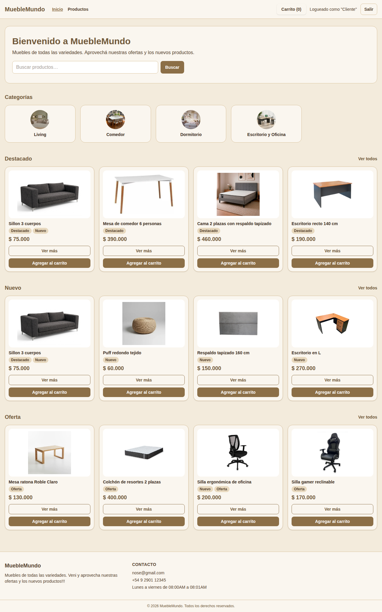 | **Catálogo** (categoría Comedor, orden por precio)<br>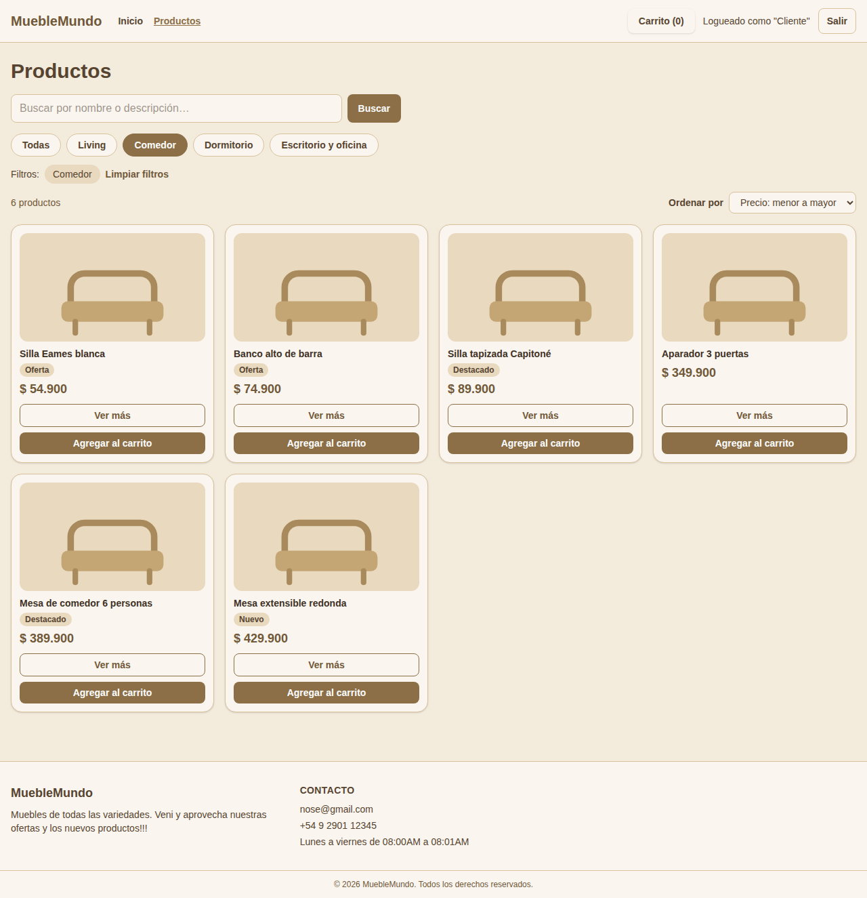 |
| **Notificación al agregar al carrito**<br>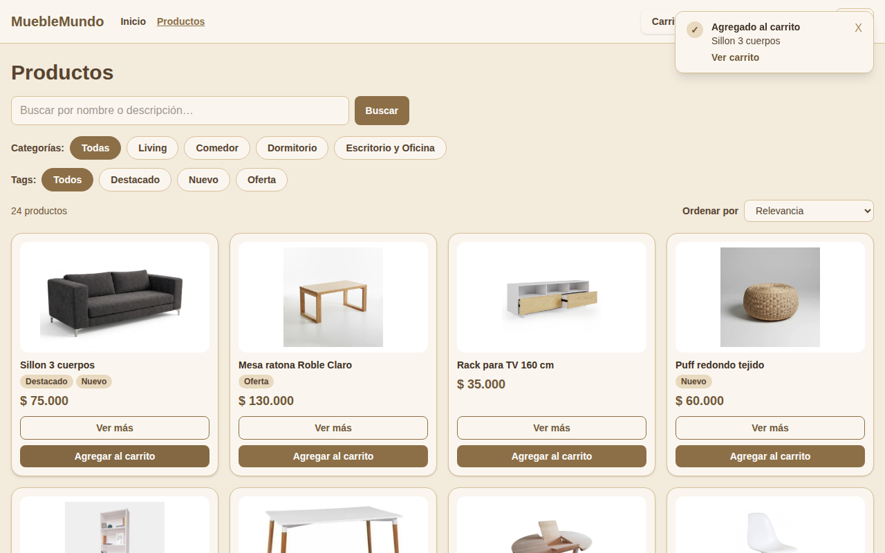 | **Login**<br>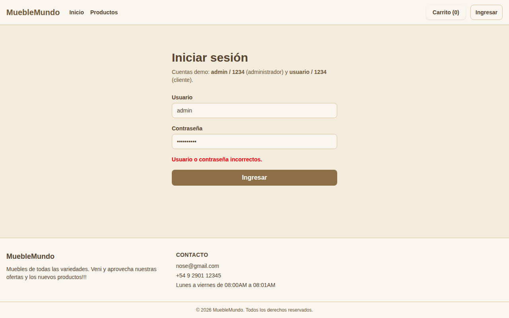 |
| **Detalle de producto**<br>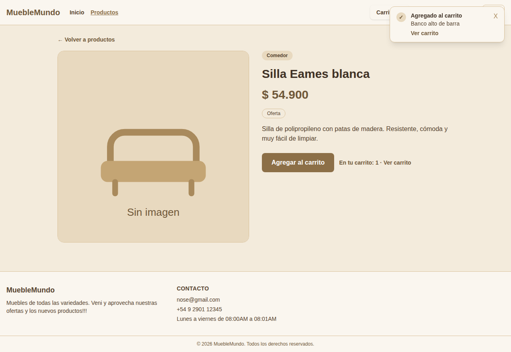 | **Carrito**<br>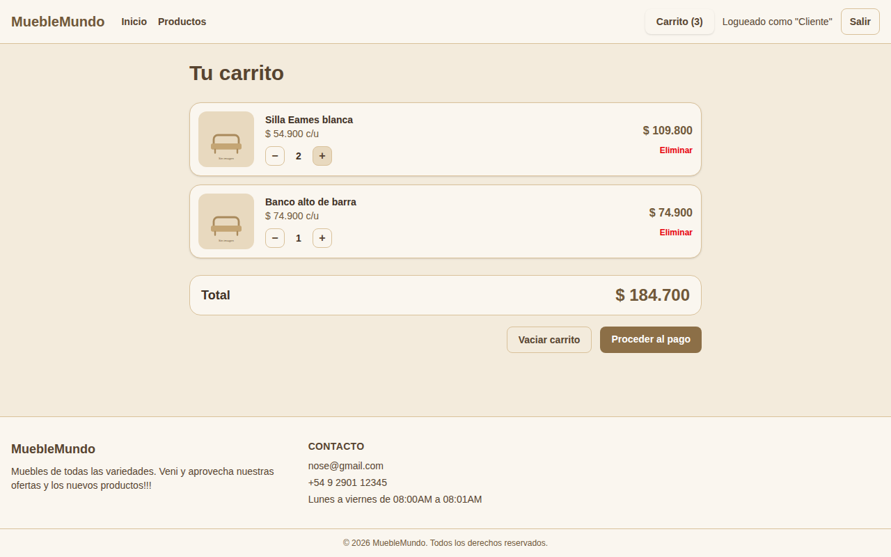 |
| **Checkout**<br>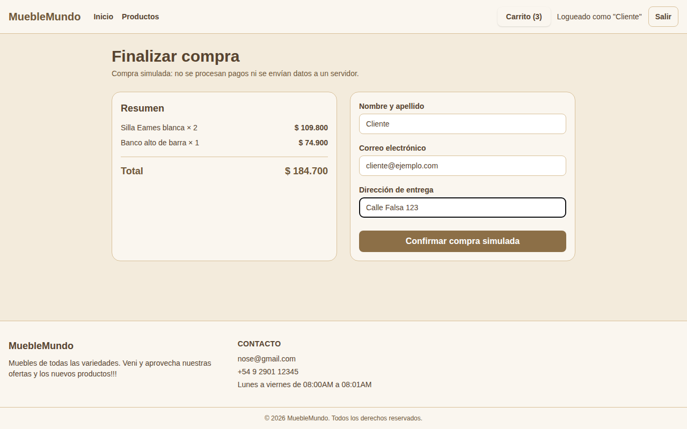 | **Compra simulada confirmada**<br>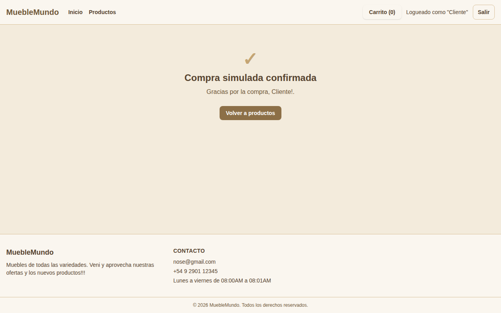 |
| **Admin: productos**<br>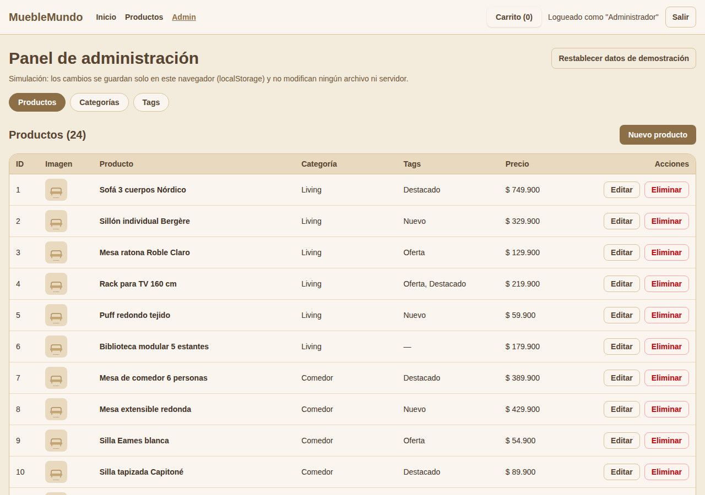 | **Admin: formulario con errores**<br>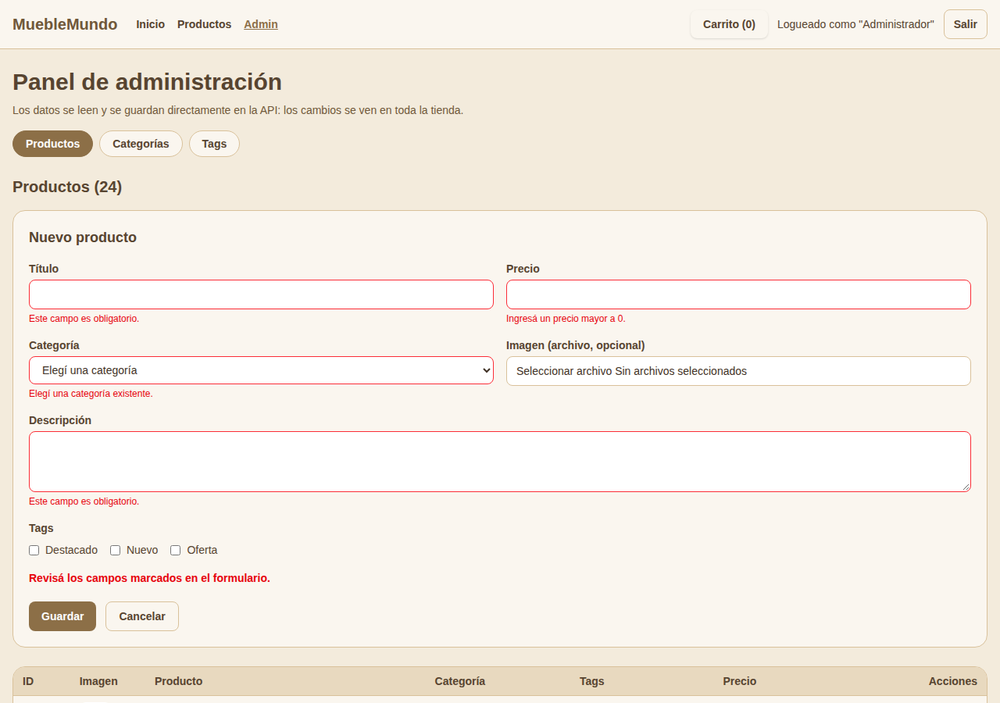 |
| **Admin: categoría con productos (borrado bloqueado)**<br>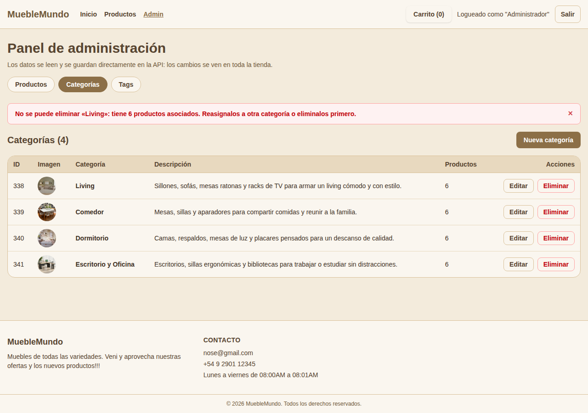 | **Admin: tags**<br>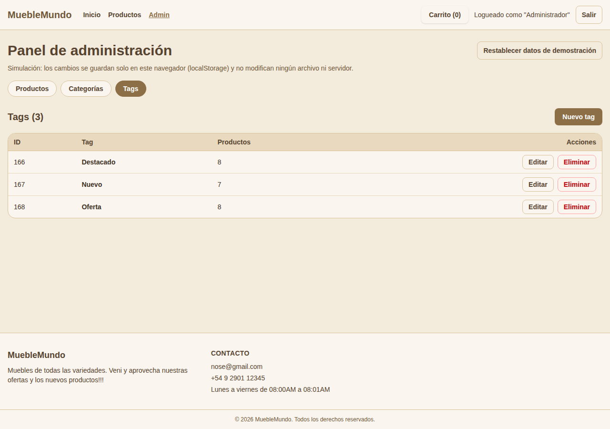 |
| **Acceso denegado (cliente en `/admin`)**<br>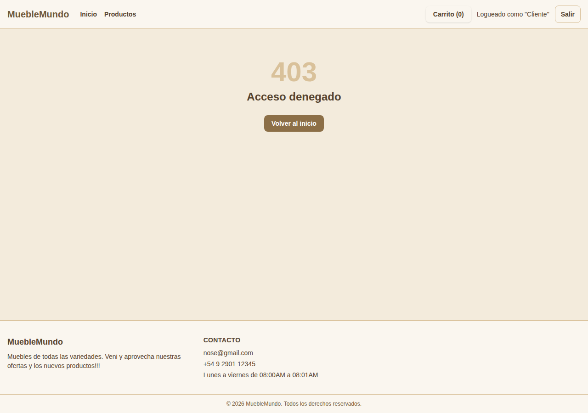 | **Página no encontrada**<br>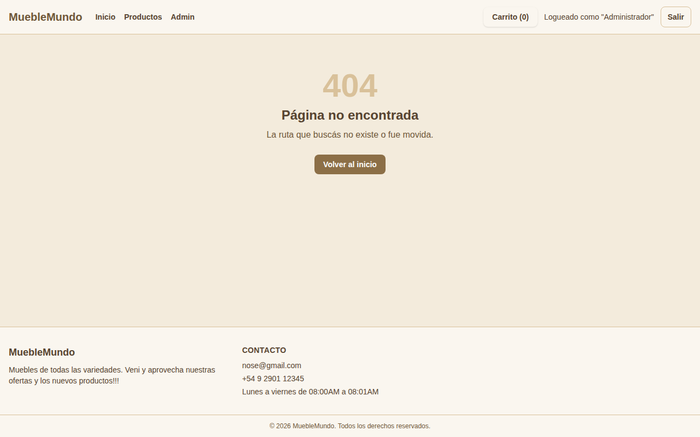 |

## Pruebas realizadas

Las pruebas se ejecutaron con un navegador automatizado (Playwright) sobre la aplicación recién instalada con `npm ci`. Resultado: **72 de 72 casos correctos**. Además, `npm run lint` y `npm run build` pasan sin errores y la versión compilada carga el catálogo y el panel.

### Casos mínimos del enunciado

| Caso | Resultado esperado | Resultado obtenido | Estado |
|---|---|---|---|
| Visitante intenta entrar a `/admin` | redirige a /login | /login | Correcto |
| Cliente intenta acceder a `/admin/productos` | redirige a /403 | /403 | Correcto |
| Administrador crea un producto | aviso de éxito y 25 filas | Producto «Mesa de centro Escandinava» creado correctamente. / filas=25 | Correcto |
| Administrador edita un producto (categoría y tags) | Comedor, Destacado y Nuevo, $160.000 + categoría Comedor, tag Nuevo, sin Oferta | 25 Mesa de centro Escandinava Comedor Destacado, Nuevo $ 160.000 EditarEliminar + ok | Correcto |
| Administrador borra un producto | 24 filas y aviso | filas=24 / Producto «Mesa de centro Escandinava» eliminado. | Correcto |
| Se elimina una categoría con productos asociados | se bloquea y explica por qué (6 productos) | No se puede eliminar «Living»: tiene 6 productos asociados. Reasignalos a otra … | Correcto |
| Cliente agrega artículos y confirma la compra | Carrito (3) con 2 artículos + pantalla de confirmación y carrito vacío | Carrito (3) / 2 artículos + confirmación visible / Carrito (0) | Correcto |
| Falla el fetch (sin red) | mensaje comprensible (No se pudo conectar) | Error: No se pudo conectar. Revisá tu conexión e intentá de nuevo. | Correcto |
| Falla el fetch (404, 500 o respuesta inválida) | mensaje comprensible (No se encontró el recurso solicitado.) + mensaje comprensible (Error del servidor (código 500).) + mensaje comprensible (no tiene un formato válido) | Error: No se encontró el recurso solicitado. + Error: Error del servidor (código 500). + Error: La respuesta del servidor no tiene un formato válido. | Correcto |
| La recarga conserva el carrito | Carrito (3) | Carrito (3) | Correcto |
| La recarga conserva los cambios simulados | 25 | 25 | Correcto |

### Pruebas adicionales

| Caso | Resultado esperado | Resultado obtenido | Estado |
|---|---|---|---|
| Login con credenciales incorrectas | mensaje de error y sigue en /login | Usuario o contraseña incorrectos. / /login | Correcto |
| Visitante entra a `/carrito` o `/checkout` | redirige a /login | /login y /login | Correcto |
| Tras iniciar sesión vuelve a la página pedida | /carrito | /carrito | Correcto |
| Visitante intenta comprar desde una tarjeta | botón «Ingresá para comprar», sin «Agregar al carrito» + va a /login | 24 enlaces, 0 botones + /login | Correcto |
| Cerrar sesión | muestra «Ingresar» y vacía el carrito + redirige a /login | Ingresar / Carrito (0) + /login | Correcto |
| Sesión alterada en el navegador intenta escribir | el servicio rechaza la operación y no borra + el servicio pide iniciar sesión | Solo el administrador puede realizar esta operación. / filas=24 + Tenés que iniciar sesión para realizar esta acción. | Correcto |
| Validación de formularios | muestra errores y no guarda + Ingresá un precio mayor a 0. + mensaje de dirección inválida | 5 mensajes, filas=24 + Ingresá un precio mayor a 0. + mensaje visible | Correcto |
| Categoría o tag con nombre repetido | Ya existe una categoría con ese nombre. | Ya existe una categoría con ese nombre. | Correcto |
| Eliminar un tag asignado a productos | se quita de los productos (8) + 0 | Tag «Oferta» eliminado. Se quitó de 8 producto(s). + 0 | Correcto |
| Búsqueda por texto y estado vacío | 4 productos + No hay productos que coincidan con los filtros. | 4 productos / /productos?q=silla + No hay productos que coincidan con los filtros. | Correcto |
| Filtro por tag desde el catálogo (botones) | Todos, Destacado, Nuevo, Oferta + 8 productos + todos incluyen «Oferta» | Todos, Destacado, Nuevo, Oferta + 8 productos / /productos?tag=168 + sí | Correcto |
| Tag combinado con categoría, y quitar el tag | 2 productos + 6 productos (Comedor) | 2 productos / /productos?tag=168&categoria=339 + 6 productos / /productos?categoria=339 | Correcto |
| Enlace directo con tag, texto y orden | 7 productos y chip «Nuevo» + 1 productos, de mayor a menor precio | 7 productos / Filtros: Nuevo Limpiar filtros + 1 productos [389900] | Correcto |
| Un tag nuevo del admin aparece en el filtro | botón «Liquidación» + No hay productos que coincidan con los filtros. + 24 productos | 1 botón + mensaje visible + 24 productos / /productos | Correcto |
| Filtros combinados (categoría + tag + texto) | 1 producto(s) | 1 producto(s) | Correcto |
| Orden por precio | precios crecientes, primero la Silla Eames blanca + precios decrecientes + 6 productos de Comedor, ordenados | Silla Eames blanca / primeros precios [54900, 59900, 74900] + primeros precios [749900, 559900, 459900] + 6 productos [54900, 74900]... | Correcto |
| Home: secciones por tag y buscador | Destacado, Nuevo y Oferta + /productos?q=mesa | Destacado, Nuevo, Oferta + /productos?q=mesa | Correcto |
| Ruta inexistente (404) | página 404 | 404 Página no encontrada La ruta que buscás no existe o fue movida. | Correcto |

El detalle completo de los casos del CRUD (44 casos) está en [`tp-web-II/docs/CRUD.md`](tp-web-II/docs/CRUD.md).

## Limitaciones y mejoras posibles

- Toda escritura es simulada y vive solo en el navegador de quien la hace; no hay backend.
- Las imágenes de los productos iniciales no están cargadas: se muestra una imagen por defecto hasta que se asigne una dirección desde el panel.
- Las cuentas demo, y su contraseña, son públicas por diseño.
- Mejora propuesta: un backend intermediario que guarde cualquier token de acceso, valide la identidad y el rol, y autorice de verdad las escrituras.
