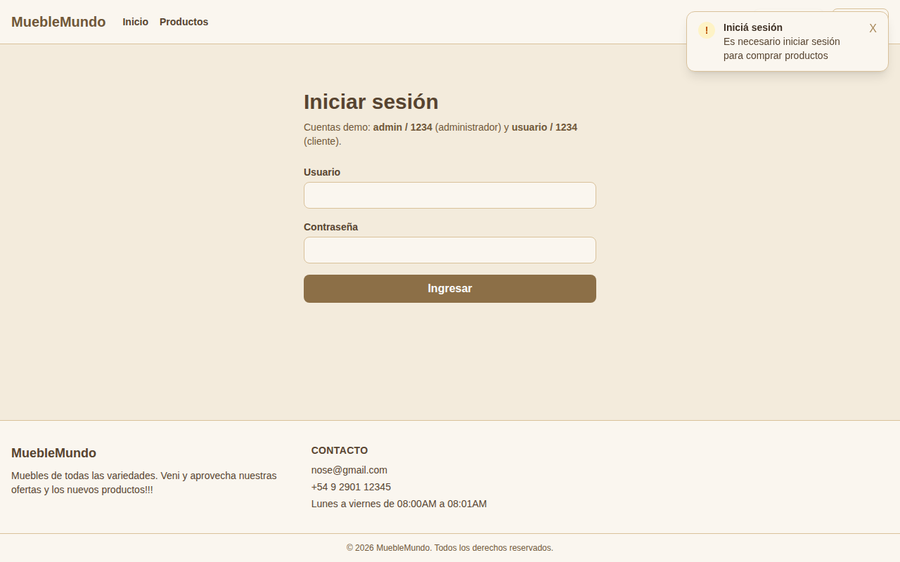

# MuebleMundo — Tienda online de muebles

Trabajo Práctico Integrador Final · Desarrollo Web 2 · UNTDF

## Integrantes

| Integrante |
|---|
| Cardona Juan David |
| Ezequiel Aranda |

Repositorio: [github.com/CardonaJuan13/Trabajo-Integrador-Web-II](https://github.com/CardonaJuan13/Trabajo-Integrador-Web-II)

SPA de e-commerce hecha con React. Tiene catálogo con búsqueda, filtros y orden, detalle de producto, login con roles, carrito, compra simulada y un panel de administración con CRUD de productos, categorías y tags.

> **Importante:** **todos los datos se traen de la API de la materia**, tanto en el catálogo como en el panel de administración; no se usa ningún archivo JSON local. Lo que se crea, edita o borra en el panel se guarda en la API y se ve en el catálogo. La seguridad es **simulada**. Mirá [Origen de los datos](#origen-de-los-datos) y [Seguridad](#seguridad).

## Índice

1. [Integrantes](#integrantes)
2. [Tecnologías](#tecnologías)
3. [Instalación y ejecución](#instalación-y-ejecución)
4. [Cuentas demo y permisos](#cuentas-demo-y-permisos)
5. [Rutas](#rutas)
6. [Origen de los datos](#origen-de-los-datos)
7. [Seguridad](#seguridad)
8. [Funcionalidades](#funcionalidades)
9. [Modelo de datos y dependencias del panel](#modelo-de-datos-y-dependencias-del-panel)
10. [Estructura del proyecto](#estructura-del-proyecto)
11. [Capturas](#capturas)
12. [Pruebas realizadas](#pruebas-realizadas)
13. [Limitaciones conocidas y mejoras posibles](#limitaciones-conocidas-y-mejoras-posibles)

## Tecnologías

### Aplicación

| Tecnología | Versión | Uso |
|---|---|---|
| [React](https://react.dev/) (`react`, `react-dom`) | 19.2 | Interfaz con componentes funcionales y hooks (`useState`, `useEffect`, `useMemo`, `useRef`) |
| React Context API | (incluida en React) | Sesión y rol del usuario compartidos en toda la app (`src/context/AuthContext.jsx`) |
| [React Router](https://reactrouter.com/) (`react-router-dom`) | 7.18 | Navegación SPA, rutas dinámicas (`/productos/:id`), rutas anidadas del panel, parámetros de búsqueda (`?q=`, `?categoria=`, `?tag=`, `?orden=`) y rutas protegidas |
| [Tailwind CSS](https://tailwindcss.com/) (`tailwindcss`, `@tailwindcss/vite`) | 4.3 | Estilos con clases utilitarias y una paleta beige propia definida en `src/index.css` |
| Fetch API | (nativa del navegador) | Pedidos `GET`, `POST`, `PUT` y `DELETE` a la API, y subida de imágenes con `FormData` |
| `localStorage` | (nativo del navegador) | Guarda la sesión simulada y el carrito |
| JavaScript (módulos ES) y JSX | — | Lenguaje de toda la aplicación |

### Herramientas de desarrollo

| Herramienta | Versión | Uso |
|---|---|---|
| [Vite](https://vite.dev/) + `@vitejs/plugin-react` | 8.3 / 6.1 | Servidor de desarrollo con recarga en caliente y compilación para producción |
| [ESLint](https://eslint.org/) + `eslint-plugin-react-hooks` + `eslint-plugin-react-refresh` | 10 | Revisión de la calidad del código y de las reglas de los hooks |
| Node.js y npm | 20.19+ / 22.12+ | Instalación de dependencias y scripts del proyecto |
| Git y GitHub | — | Control de versiones y trabajo en equipo por ramas |

### Servicios externos

| Servicio | Uso |
|---|---|
| API de la materia (`https://ecommerce.fedegonzalez.com`) | Origen de todos los productos, categorías, tags e imágenes. Ver [Origen de los datos](#origen-de-los-datos) |

## Instalación y ejecución

**Requisitos:** Node.js 20.19 o superior (o 22.12 o superior), npm y conexión a internet (el catálogo consulta la API de la materia).

```bash
cd tp-web-II
npm install        # instala las dependencias
npm run dev        # servidor de desarrollo (por defecto: http://localhost:5173)
```

| Comando | Descripción |
|---|---|
| `npm run build` | Genera la versión de producción en `dist/` |
| `npm run preview` | Sirve `dist/` localmente para probarla |
| `npm run lint` | Revisa el código con ESLint |

**Token de la API:** `src/api.js` trae un token por defecto. Para usar otro se puede crear un archivo `.env` con `VITE_API_TOKEN=tu_token` y reiniciar `npm run dev`. Ver [Seguridad](#seguridad).

## Cuentas demo y permisos

| Usuario | Contraseña | Rol |
|---|---|---|
| `admin` | `1234` | Administrador |
| `usuario` | `1234` | Cliente |

| Acción | Visitante | Cliente | Admin |
|---|---|---|---|
| Ver catálogo y detalle | Sí | Sí | Sí |
| Buscar, filtrar y ordenar | Sí | Sí | Sí |
| Agregar al carrito / comprar | Debe iniciar sesión | Sí | Sí |
| CRUD de productos | No | No | Sí |
| CRUD de categorías | No | No | Sí |
| CRUD de tags | No | No | Sí |

## Rutas

| Ruta | Pantalla | Acceso |
|---|---|---|
| `/` | Inicio: categorías, secciones por tag y buscador | Público |
| `/productos` | Catálogo con búsqueda, filtros, orden y estados de carga, error y vacío | Público |
| `/productos/:id` | Detalle de un producto | Público |
| `/login` | Inicio y cierre de sesión | Público |
| `/carrito` | Carrito | Requiere sesión (`ProtectedRoute`) |
| `/checkout` | Confirmación de compra simulada | Requiere sesión (`ProtectedRoute`) |
| `/admin` | Redirige a `/admin/productos` | Solo admin (`AdminRoute`) |
| `/admin/productos` | CRUD de productos | Solo admin |
| `/admin/categorias` | CRUD de categorías | Solo admin |
| `/admin/tags` | CRUD de tags | Solo admin |
| `/403` | Acceso denegado | Público |
| `*` | Página no encontrada (404) | Público |

Sin sesión, las rutas protegidas redirigen a `/login` y, después de ingresar, se vuelve a la página que se había pedido. Si un cliente intenta entrar a `/admin/*`, va a `/403`.

## Origen de los datos

**Todos los datos vienen de la API de la materia** (`https://ecommerce.fedegonzalez.com`), siempre con el encabezado `Authorization: Bearer <token>`. **No se usa ningún archivo JSON local**: el antiguo `src/data/api-fake.json` y la copia del panel en `localStorage` se eliminaron.

| Parte | Endpoints | Lo resuelve |
|---|---|---|
| Catálogo (Inicio, Productos y Detalle) | `GET /products/`, `GET /categories/` y `GET /tags/` | `src/api.js` |
| Panel de administración (CRUD) | `GET`, `POST`, `PUT` y `DELETE` sobre `/products/`, `/categories/` y `/tags/`, y subida de imágenes con `POST /products/{id}/pictures` y `POST /categories/{id}/picture` | `src/services/` |

- **Los cambios del panel son reales:** quedan guardados en la API y se ven en el catálogo, desde cualquier navegador.
- La API guarda los datos **por token**: cada token tiene su propio catálogo.
- `localStorage` solo guarda la sesión simulada (`sesionLS`) y el carrito (`carritoMuebles`).

## Seguridad

La seguridad de esta aplicación es **simulada**; no hay un servidor que valide nada:

- Las cuentas demo y sus contraseñas están escritas en el código (`src/context/AuthContext.jsx`) y la sesión vive en `localStorage`, por lo que cualquiera puede modificarla desde las herramientas del navegador.
- `ProtectedRoute` y `AdminRoute` controlan lo que se muestra en la interfaz, pero no son una barrera de seguridad.
- Antes de cada operación del panel, la capa de servicio vuelve a validar el rol (`src/services/permisos.js`). Tampoco reemplaza al servidor: como el panel escribe en la API real, **cualquiera que tenga el token puede modificar los datos**.
- **El token de la API está en el código del front** (`src/api.js`, por defecto o desde `VITE_API_TOKEN`). Todo lo que está en el código de React, incluidas las variables `VITE_*`, llega al navegador y puede verse en las herramientas del navegador, así que **ese token no es secreto** y no se debe usar para nada sensible. Es una limitación respecto de la recomendación del enunciado de no incrustar el token en el front: una solución real necesita un backend o proxy que lo guarde y valide la identidad y el rol antes de permitir escrituras.

## Funcionalidades

- **Inicio:** categorías, secciones por tag (Destacado, Nuevo, Oferta) y buscador que lleva al catálogo.
- **Catálogo:** búsqueda por texto (sin distinguir mayúsculas ni tildes), botones de filtro por categoría y por tag (combinables entre sí y con la búsqueda), orden por precio, contador de resultados y tarjetas con imagen, tags y precio.
- **Detalle:** imágenes, categoría, tags, descripción y precio. Un visitante ve "Ingresá para comprar".
- **Aviso para visitantes:** si un visitante sin sesión quiere entrar al carrito (o al checkout) o toca "Ingresá para comprar", va a `/login` y aparece la notificación **«Es necesario iniciar sesión para comprar productos»**. Después de ingresar vuelve a la página que había pedido.
- **Login:** cuentas demo, mensajes de error y regreso a la página pedida.
- **Carrito:** agregar, sumar y restar cantidades, eliminar, vaciar y total. Se conserva al recargar y se vacía al cerrar sesión.
- **Checkout:** formulario con datos de entrega y confirmación de compra simulada (no hay cobro ni pedido real).
- **Notificaciones:** al agregar un producto al carrito y al pedirle a un visitante que inicie sesión para comprar.
- **Panel de administración:** tabla y formulario por módulo conectados a la API, subida de imágenes, validaciones, mensajes de éxito y error, y confirmación antes de borrar.

## Modelo de datos y dependencias del panel

- La API devuelve cada producto con `id`, `title`, `description`, `price`, `category_id`, `pictures`, `category` y `tags`. Las categorías tienen `id`, `title`, `description` y `picture`; los tags, `id` y `title`.
- Las imágenes se suben como archivo (la API no acepta direcciones de imagen).
- Cada producto referencia una categoría y cero o más tags.

| Acción en el panel | Resultado |
|---|---|
| Editar el título de una categoría | Sus productos muestran el nombre nuevo |
| Cambiar la categoría o los tags de un producto | Se actualiza en el panel y en el catálogo |
| Eliminar una categoría sin productos | Se elimina |
| Eliminar una categoría **con** productos | **Se bloquea** y se informa cuántos tiene; hay que reasignarlos o eliminarlos primero |
| Eliminar un tag | Se quita de todos los productos que lo tenían |
| Eliminar un producto | Se elimina de la API y del catálogo |

El detalle de validaciones, mensajes de error y organización de los servicios está en [`tp-web-II/docs/CRUD.md`](tp-web-II/docs/CRUD.md).

## Estructura del proyecto

```
Trabajo-Practico-Web-II/
├── README.md
└── tp-web-II/
    ├── index.html
    ├── package.json · vite.config.js · eslint.config.js
    ├── docs/
    │   ├── CRUD.md                  # Documentación y pruebas del panel
    │   └── capturas/                # Capturas de pantalla
    ├── public/                      # favicon e imagen por defecto
    ├── data/
    │   ├── cart.js                  # Estado del carrito (localStorage)
    │   └── toast.js                 # Notificaciones (carrito y aviso de iniciar sesión)
    └── src/
        ├── main.jsx · App.jsx       # Punto de entrada y rutas
        ├── api.js                   # URL y token de la API, lecturas del catálogo y urlImagen
        ├── index.css                # Tailwind y paleta beige
        ├── context/AuthContext.jsx  # Sesión y roles (simulados)
        ├── services/                # CRUD del panel contra la API, permisos y validaciones
        ├── components/              # Encabezado, pie, tarjetas, listado, ficha, carrito, rutas protegidas
        │   └── admin/               # Piezas del panel (aviso, campo, diálogo, hooks)
        └── pages/                   # Login, Checkout, 403, 404 y panel de administración
            └── admin/               # Productos, categorías y tags
```

## Capturas

Tomadas con la aplicación conectada a la API real, con los productos, categorías e imágenes cargados en el token.

| | |
|---|---|
| **Inicio**<br> | **Catálogo** (categoría Comedor, orden por precio)<br> |
| **Notificación al agregar al carrito**<br> | **Login**<br> |
| **Detalle de producto**<br> | **Carrito**<br> |
| **Checkout**<br> | **Compra simulada confirmada**<br> |
| **Panel: productos**<br> | **Panel: formulario con errores**<br> |
| **Panel: categoría con productos (borrado bloqueado)**<br> | **Panel: tags**<br> |
| **Acceso denegado (cliente en `/admin`)**<br> | **Página no encontrada**<br> |
| **Aviso al visitante que quiere entrar al carrito**<br> | |

## Pruebas realizadas

Las pruebas se ejecutaron con un navegador automatizado (Playwright) sobre la aplicación en modo desarrollo. Como las pruebas automáticas no tenían acceso a la API real, **las respuestas de la API se simularon** (mismo formato de datos, imágenes con rutas relativas y un producto sin imagen). Además, `npm run lint` y `npm run build` pasan sin errores.

> Estas pruebas se hicieron cuando el panel usaba una copia local de los datos. Al conectarlo a la API se quitaron los casos que ya no aplican (restablecer datos, conservar cambios locales, imagen por dirección y "lo creado en el panel no aparece en el catálogo"). **Hay que volver a ejecutar las pruebas del panel contra la API**: los números de filas dependen de los datos del token.

### Casos mínimos del enunciado

| Caso | Resultado esperado | Resultado obtenido | Estado |
|---|---|---|---|
| Visitante intenta entrar a `/admin` | redirige a /login | /login | Correcto |
| Cliente intenta acceder a `/admin/productos` | redirige a /403 | /403 | Correcto |
| Administrador crea un producto | aviso de éxito y 25 filas | Producto «Mesa de centro Escandinava» creado correctamente. / filas=25 | Correcto |
| Administrador edita un producto (categoría y tags) | Comedor, Destacado y Nuevo, $160.000 | 25 Mesa de centro Escandinava Comedor Destacado, Nuevo $ 160.000 Edit… | Correcto |
| Administrador borra un producto | 24 filas y aviso | filas=24 / Producto «Mesa de centro Escandinava» eliminado. | Correcto |
| Se elimina una categoría con productos asociados | se bloquea y explica por qué (6 productos) | No se puede eliminar «Living»: tiene 6 productos asociados. Reasignal… | Correcto |
| Cliente agrega artículos y confirma la compra | Carrito (3) con 2 artículos + pantalla de confirmación y carrito vacío | Carrito (3) / 2 artículos + confirmación visible / Carrito (0) | Correcto |
| Falla el fetch del panel (sin red) | mensaje comprensible (No se pudo conectar) | No se pudo conectar. Revisá tu conexión e intentá de nuevo. | Correcto |
| Falla el fetch del panel (404, 500 o respuesta inválida) | mensaje comprensible (No se encontró el recurso solicitado.) + mensaje comprensible (Error del servidor (código 500).) + mensaje comprensible (no tiene un formato válido) | No se encontró el recurso solicitado. + Error del servidor (código 500). + La respuesta del servidor no tiene un formato válido. | Correcto |
| Falla la API del catálogo (sin red) | mensaje de error visible (Error:) | Error: Failed to fetch | Correcto |
| Falla la API del catálogo (401 o 500) | mensaje de error visible (Error de la API 401) + mensaje de error visible (Error de la API 500) | Error: Error de la API 401 + Error: Error de la API 500 | Correcto |
| La recarga conserva el carrito | Carrito (3) | Carrito (3) | Correcto |

### Pruebas adicionales

| Caso | Resultado esperado | Resultado obtenido | Estado |
|---|---|---|---|
| Login con credenciales incorrectas | mensaje de error y sigue en /login | Usuario o contraseña incorrectos. / /login | Correcto |
| Visitante entra a `/carrito` o `/checkout` | redirige a /login | /login y /login | Correcto |
| Visitante entra a `/carrito` (aviso) | va a /login con la notificación «Es necesario iniciar sesión para comprar productos» | /login + notificación visible | Correcto |
| Tras iniciar sesión vuelve a la página pedida | /carrito | /carrito | Correcto |
| Visitante intenta comprar desde una tarjeta | botón «Ingresá para comprar», sin «Agregar al carrito» + va a /login | 24 enlaces, 0 botones + /login | Correcto |
| Cerrar sesión | muestra «Ingresar» y vacía el carrito + redirige a /login | Ingresar / Carrito (0) + /login | Correcto |
| Sesión alterada en el navegador intenta escribir | el servicio rechaza la operación y no borra + el servicio pide iniciar sesión | Solo el administrador puede realizar esta operación. / filas=24 + Tenés que iniciar sesión para realizar esta acción. | Correcto |
| Validación de formularios del panel | muestra errores y no guarda + Ingresá un precio mayor a 0. | 5 mensajes, filas=24 + Ingresá un precio mayor a 0. | Correcto |
| Categoría con nombre repetido | Ya existe una categoría con ese nombre. | Ya existe una categoría con ese nombre. | Correcto |
| Eliminar un tag asignado a productos | se quita de los productos (8) + 0 | Tag «Oferta» eliminado. Se quitó de 8 producto(s). + 0 | Correcto |
| El catálogo muestra los productos de la API | 24 | 24 | Correcto |
| Imágenes que vienen de la API | 23 imágenes visibles | 23 imágenes visibles | Correcto |
| Búsqueda por texto y estado vacío | 4 productos + No hay productos que coincidan con los filtros. | 4 productos / /productos?q=silla + mensaje visible | Correcto |
| Filtros combinados (categoría + tag + texto) | 1 producto(s) | 1 producto(s) | Correcto |
| Filtro por tag desde los botones del catálogo | Todos, Destacado, Nuevo, Oferta + 8 productos | Todos, Destacado, Nuevo, Oferta + 8 productos / /productos?tag=168 | Correcto |
| Tag combinado con categoría, y quitar el tag | 2 productos + 6 productos (Comedor) | 2 productos + 6 productos / /productos?categoria=339 | Correcto |
| Orden por precio | precios crecientes + precios decrecientes + 2 productos, ordenados | primeros precios [54900, 59900, 74900] + primeros precios [749900, 559900, 459900] + 2 productos [89900, 389900] | Correcto |
| Home: secciones por tag y buscador | Destacado, Nuevo y Oferta + /productos?q=mesa | Destacado, Nuevo, Oferta + /productos?q=mesa | Correcto |
| Detalle de producto (existente e inexistente) | título, precio y categoría del producto 1 + No encontramos ese producto. | ← Volver a productos Living Sofá 3 cuerpos Nórdico $ 749.900 Destacad… + No encontramos ese producto. | Correcto |
| Ruta inexistente (404) | página 404 | 404 Página no encontrada La ruta que buscás no existe o fue movida. | Correcto |

El detalle de los casos del panel está en [`tp-web-II/docs/CRUD.md`](tp-web-II/docs/CRUD.md).

## Limitaciones conocidas y mejoras posibles

- **Escritura directa desde el front:** el panel llama a `POST`, `PUT` y `DELETE` de la API con el token incluido en el código. Lo ideal sería hacerlo a través de un backend intermediario que valide el rol.
- **Token en el front:** ver [Seguridad](#seguridad).
- **Archivos de etapas anteriores sin uso** (se pueden borrar): `src/components/listado-main.jsx`, `carrito-main.jsx` y `ficha-main.jsx`, `src/router.js`, `data/home.js`, `data/categoria.js` y la dependencia `lit` (solo la usan esos dos archivos).
- Las cuentas demo y su contraseña son públicas por diseño.
## Documentacion by Claude
